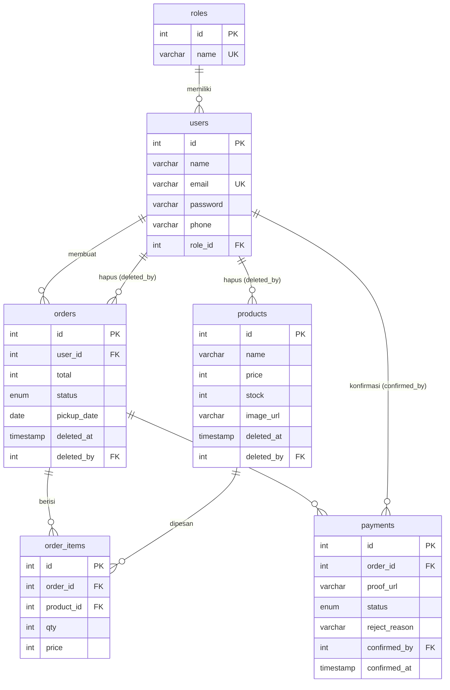

# MyCake Backend

REST API untuk aplikasi pemesanan kue jarak jauh. Customer memesan kue dari aplikasi, kasir mengonfirmasi pembayaran dan melihat rekap harian, admin (pemilik toko) memantau semuanya.

## Teknologi

Node.js, Express 5, TypeScript, MySQL, Drizzle ORM, JWT, bcryptjs, zod, multer, Cloudinary.

## Role

| Role | Hak akses |
|---|---|
| customer | Daftar sendiri, lihat kue, pesan, upload bukti bayar, lihat dan batalkan pesanan sendiri (status pending) |
| kasir | CRUD kue (soft delete), lihat semua pesanan, konfirmasi atau tolak pembayaran, selesaikan pesanan, rekap hari ini, soft delete pesanan |
| admin | Semua hak kasir, ditambah rekap semua tanggal, tong sampah, dan restore data terhapus |

Akun kasir dan admin dibuat lewat seeder. Endpoint register selalu membuat customer.

## Menjalankan

```bash
npm install
cp .env.example .env     # Windows: copy .env.example .env, lalu isi nilainya
npm run db:migrate       # membuat tabel
npm run db:seed          # mengisi role dan akun uji
npm run dev              # http://localhost:3000
```

Buat database kosong bernama `mycake` di MySQL (Laragon) sebelum migrasi.

### Variabel `.env`

| Nama | Keterangan |
|---|---|
| `PORT` | Port server (default 3000) |
| `DB_HOST`, `DB_PORT`, `DB_USER`, `DB_PASSWORD`, `DB_NAME` | Koneksi MySQL |
| `DATABASE_URL` | URL koneksi untuk drizzle-kit |
| `JWT_SECRET`, `JWT_EXPIRES_IN` | Penandatanganan token |
| `CLOUDINARY_CLOUD_NAME`, `CLOUDINARY_API_KEY`, `CLOUDINARY_API_SECRET` | Penyimpanan gambar |

### Script

| Perintah | Fungsi |
|---|---|
| `npm run dev` | Menjalankan server dengan auto-reload |
| `npm run db:generate` | Membuat file migrasi dari `schema.ts` |
| `npm run db:migrate` | Menjalankan migrasi |
| `npm run db:seed` | Mengisi data awal (aman dijalankan berulang) |
| `npm run db:studio` | Membuka Drizzle Studio |

## Akun uji

| Role | Email | Password |
|---|---|---|
| admin | admin@mycake.com | admin123 |
| kasir | kasir1@mycake.com | kasir123 |
| kasir | kasir2@mycake.com | kasir123 |
| customer | customer@mycake.com | customer123 |

## Alur status

| Kejadian | Status pesanan | Status pembayaran |
|---|---|---|
| Pesanan dibuat | pending | - |
| Customer upload bukti | waiting_confirmation | waiting |
| Kasir konfirmasi | confirmed | confirmed |
| Kasir tolak | pending (upload ulang) | rejected |
| Kue diambil | completed | - |
| Customer batalkan (saat pending) | cancelled | - |

Stok berkurang saat pesanan dibuat dan dikembalikan saat pesanan dibatalkan atau dihapus.

## Format respons

```json
{ "success": true, "message": "...", "data": {} }
{ "success": false, "message": "...", "errors": [{ "field": "email", "message": "..." }] }
```

Kode status: 200, 201, 400 (validasi), 401 (belum login), 403 (role tidak diizinkan), 404, 409, 500.

## Endpoint

Semua endpoint selain register, login, dan health memerlukan header `Authorization: Bearer <token>`.

| Method | URL | Akses |
|---|---|---|
| GET | `/api/health` | Publik |
| POST | `/api/auth/register` | Publik |
| POST | `/api/auth/login` | Publik |
| GET | `/api/auth/me` | Login |
| GET | `/api/products?search=` | Login |
| GET | `/api/products/:id` | Login |
| POST | `/api/products` (form-data, `image`) | kasir, admin |
| PUT | `/api/products/:id` (form-data, `image`) | kasir, admin |
| PATCH | `/api/products/:id/stock` (`{ "add": 10 }`) | kasir, admin |
| DELETE | `/api/products/:id` (soft delete) | kasir, admin |
| POST | `/api/orders` | customer |
| GET | `/api/orders/my` | customer |
| GET | `/api/orders?status=` | kasir, admin |
| GET | `/api/orders/:id` | pemilik, kasir, admin |
| PATCH | `/api/orders/:id/cancel` | customer (pemilik) |
| DELETE | `/api/orders/:id` (soft delete) | kasir, admin |
| POST | `/api/orders/:id/payment` (form-data, `proof`) | customer (pemilik) |
| GET | `/api/orders/:id/payment` | pemilik, kasir, admin |
| GET | `/api/payments?status=` | kasir, admin |
| PATCH | `/api/orders/:id/payment/confirm` | kasir, admin |
| PATCH | `/api/orders/:id/payment/reject` (`{ "reason": "..." }`) | kasir, admin |
| PATCH | `/api/orders/:id/complete` | kasir, admin |
| GET | `/api/recap/today` | kasir, admin |
| GET | `/api/recap?from=&to=` | admin |
| GET | `/api/trash` | admin |
| PATCH | `/api/trash/orders/:id/restore` | admin |
| PATCH | `/api/trash/products/:id/restore` | admin |

Koleksi Postman tersedia di `MyCake_API.postman_collection.json`.

## ERD



## Catatan desain

- **Soft delete** pada `products` dan `orders` memakai `deleted_at` dan `deleted_by`, sehingga admin dapat memantau siapa yang menghapus dan mengembalikan datanya.
- **Total pesanan dihitung server** dari harga di database, dan harga saat pesan disimpan di `order_items.price`.
- **Transaksi database** dipakai saat membuat dan membatalkan pesanan agar stok selalu konsisten.
- **Password** disimpan sebagai hash bcrypt, dan role dibaca dari token JWT, bukan dari input client.
- **Upload gambar** divalidasi (JPG, PNG, WEBP, maksimal 2 MB) sebelum dikirim ke Cloudinary.